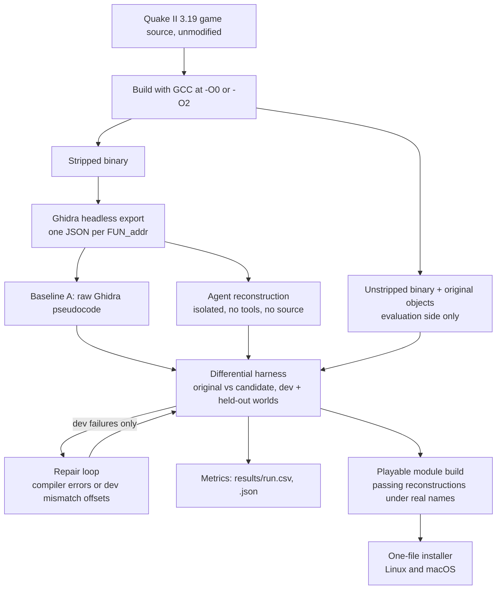

# quake2-llm-decompile

Code, test harness and saved results for the study
[Agent-Assisted Reconstruction of Quake II Gameplay Code](https://palindromerice.github.io/writing/quake2-reconstruction/).

Quake II's gameplay module (about a thousand C functions) is compiled, stripped of symbols and
decompiled with Ghidra. Coding agents then rewrite each function in C without seeing the source,
and a differential harness compares every rewrite against the original on generated game worlds.
Raw decompiler output matches the original for fewer than 9% of functions. After agent
reconstruction and repair, **99.0%** of testable functions match in the unoptimized build
(981 of 991) and **98.5%** in the optimized build (964 of 979). The reconstructed functions also
run together as a real game: the installed module uses reconstructed code for 1,018 of its 1,019
functions and is playable in the open-source Yamagi Quake II engine on Linux and Mac.

## Why

Decompilers recover structure from binaries, but their output rarely compiles or behaves like the
original without manual repair. Most game decompilation projects aim for *matching* output (C that
compiles back to the same bytes), which needs the original compiler and a lot of effort per
function. This project asks a different question: can agents produce code that simply *behaves*
like the original, which is what porting, modding and preservation need?

A game is a hard test. Functions share global state, call each other and depend on exact data
layouts, so a function can pass on its own and still break the game. Quake II is a good subject:
large and stateful enough to be realistic, with id Software's GPL source release available as
ground truth. The idea is to give agents only what a decompiler recovers, give them a strict
machine-checkable signal (behavioral tests, not byte matching), and then check the result by
actually playing the game.

## System design



**1. Build and strip.** `scripts/build_pilot.py` compiles unmodified game sources (from id
Software's release, cloned at a pinned commit into a git-ignored `third_party/`) with the flags in a
config. It produces a debug copy and the original object files (evaluation side only), the stripped
binary (the only thing Ghidra and the agent see), a name-to-address ground truth, and a
`build_info.json` with compiler version, commands and hashes. Two optimization levels are studied:
`-O0` keeps machine code close to the source; `-O2` inlines and removes code as shipped games do.

**2. Ghidra extraction.** `src/extraction/run_ghidra.py` runs Ghidra headless with
`ghidra_scripts/ExportFunctions.java`. For each target it writes one agent input file holding only
what Ghidra recovered: pseudocode, disassembly, guessed signature, callers and callees, constants.
Targets are selected by address through the ground truth, but no original name enters these files.
Functions Ghidra never finds (8 in the optimized build) count as failures; their known addresses are
not forced in, which would leak ground truth.

**3. Reconstruction.** `src/evaluation/baseline_a.py` produces baseline A: the pseudocode with
standard headers and typedefs for Ghidra's pseudo-types, no semantic edits.
`src/reconstruction/single_pass.py` makes one agent call per function (baseline B). The prompt
text is versioned and recorded with each run; the current version states the optimization level and
asks for globals to be declared `extern` under their Ghidra names.

The model backend is a plain interface. Every call goes through `AGENT_CMD`, any command that reads
the prompt on stdin and prints the answer on stdout, either as plain text or as a JSON object with a
`result` field (optionally also usage, cost and an isolation-violation flag). The command runs from
an empty temporary directory, and the wrapper behind it must give the model no tools, no web access
and no user or project settings; an answer that reports an isolation violation is kept for the
record but never used. `AGENT` is a label (`agent_a`, `agent_b`) stored with each answer. The
experiments used two coding agent configurations, recorded as agent A and agent B.

**4. Differential testing.** `src/evaluation/difftest.py` compiles a candidate, binds Ghidra names
(`FUN_`, `DAT_`, `PTR_`, `_UNK_` at evaluation-binary addresses) to the original symbols, and runs it
against the original object code. Small pure functions from the pilot use per-function drivers in
`tests/difftest/` that compare return bit patterns and argument buffers with guard words. Game
functions use the stateful harness `tests/stateful/harness.c`: for each case two forked children
build the same seeded random world, one calls the original and one the candidate, and the parent
compares entity, player, game and level state, return values, random-number use and the log of every
engine call. The engine is a deterministic stand-in, so any behavioral difference shows up. Pointer
values are compared by meaning: function pointers resolve to the same function in both builds, a
pointer to the candidate itself counts as a pointer to the original, and heap addresses are left out
while the records they point to are compared. Signatures (argument kinds the harness can generate)
come from `scripts/make_file_config.py`; 28 functions per build have signatures the harness cannot
call (file I/O, variadic, matrices and similar) and are compile-checked only.

**5. Repair loop.** `src/reconstruction/repair.py` gives each failing function its original prompt,
its previous answer and mechanical feedback: compiler errors, or where the first difference occurred
on dev worlds (state offsets, never original names). Up to two rounds were run. For functions the
harness cannot call, `experiments/playable/ingame_feedback.json` can supply behavior observed in the
running game. Held-out results are never shown to repair.

**6. Playable module.** `scripts/make_ai_source.py` generates a portable C source tree of the game
module in which each replaced function's original body is renamed `<name>__orig`, and the
reconstruction (`ai/FUN_<addr>.c`, renamed to the real function name) provides the symbol to every
caller, including function-pointer tables. Data the reconstructions read by address is bound with
assembler aliases in the defining file, and integer literals equal to a symbol address are rewritten
into references to that symbol. A repaired version is used if it passed both splits, else a passing
first attempt, else (optionally) a compiled first attempt for the untested functions.
`scripts/build_ai_gameso.py` is an older x86-64 Linux path that patches the original functions with
jumps instead. The game is checked with scripted headless play (`playable_demo.py`), a
save/load and level-change test (`saveload_test.py`) and a multi-map soak test (`soak_test.py`), each
run on the original and reconstructed builds. `varargs_scan.py` and `macho_check.py` check
portability hazards for Apple arm64.

**7. Installer.** `scripts/make_installer.sh` packs the source tree into a one-file installer
(template in `scripts/installer_template.sh`), published as a download on the
[v1.0 release](https://github.com/palindromeRice/quake2-llm-decompile/releases/tag/v1.0). The installer downloads SDL2, Yamagi Quake II and id
Software's free demo data (three levels), each pinned by SHA-256, builds everything in one user-owned
folder and creates a menu entry on Linux or an app on macOS. A purchased game's data unlocks all
levels. On Apple Silicon it builds x86-64 and runs under Rosetta 2, because some reconstructions
keep the x86-64 convention for returning structures. The installed build keeps the original version
of the one function that moves doors and platforms (its reconstruction assumed a memory layout of
globals that failed on macOS); `make_ai_source.py` takes such exclusions as a list with reasons.

## Evaluation design

- **Splits.** Each function is tested on up to 1,500 generated worlds in a dev split and 1,500 in a
  held-out split from a different seed. Repair sees only dev failures, so held-out stays an
  independent check at the function level.
- **Usable worlds.** If the original crashes or hangs on a world, that world is skipped. If only the
  candidate fails, it is a mismatch. The number of usable worlds therefore varies by function.
- **Pass.** No mismatch **and** at least one usable world in both splits. A pass means agreement on
  the tested worlds, never proven equivalence.
- **Zero-case audit.** The harness reports a pass when the original fails on every world and nothing
  is compared. These false passes are excluded from the reported numbers (10 at `-O0`, 9 at `-O2`).
  The harness itself was not changed for this, so raw rows in `results/` still contain them.
- **Bug injection.** `scripts/mutation_check.py` makes single-edit mutants of the original functions
  (relational and arithmetic operators, constant plus one, `&&` and `||`) and counts how many the
  harness catches. On 100 sampled game functions it caught 269 of 329 (82%).
- **Controls.** `tests/test_difftest_controls.py` checks that the original logic passes and a
  one-constant mutant fails. A contamination control set of ten newly written functions
  (`experiments/control/`), each shaped like a pilot function, runs through the same pipeline: the
  first agent response passed 10 of 10 at `-O0` and 9 of 10 at `-O2`.
- **Stage accounting.** "After repair" counts a function if any saved attempt passed, so it measures
  how far the process got. Measured against all functions in each binary, the rates are 96.3% and 95.0%.

## Results

| Stage | Unoptimized (991 functions) | Optimized (979 functions) |
|---|---:|---:|
| Ghidra baseline | 86 (8.7%) | 76 (7.8%) |
| First agent response | 949 (95.8%) | 918 (93.8%) |
| After repair | 981 (99.0%) | 964 (98.5%) |

The two builds used different agent configurations and function sets, so the gap between them is not
purely an optimization effect. In the optimized run agent A and agent B split the work by run order,
not at random, so per-agent numbers are not a model comparison.

Playing the game exposed failures the isolated tests missed: hardcoded test-binary addresses in
save/load code, a weapon-switching function that assumed a 120-byte item record instead of 136, code
that depended on the x86-64 structure-passing convention, and the door-movement function's memory
layout assumption on macOS. The installed module includes 28 reconstructed functions the harness
never tested, so 1,018 reconstructed does not mean 1,018 verified; original data, declarations and
glue code also remain.

### Evidence in this repository

Raw run records (prompts, answers, reconstructions) are kept by the author and not published. The
files in `results/` are enough to recompute every number above: each CSV has one row per function and
attempt with its category, pass flags for the dev and held-out splits, and the test-case counts used
by the zero-case audit (a pass counts only when both splits compared at least one case).

| File | Backs |
|---|---|
| `results/20261013-010856-game_all_O0.csv` | Table, unoptimized build: 86 / 949 / 981 of 991 |
| `results/20261013-095717-game_all_O2.csv` | Table, optimized build: 76 / 918 / 964 of 979 |
| `results/mutation_game_all_O0_sample100.json` | Bug injection: 269 of 329 mutants caught (82%) |
| `results/20261012-225442-control_O0.csv` | Newly written control functions, unoptimized: 10 of 10 pass |
| `results/20261012-225643-control_O2.csv` | Newly written control functions, optimized: 9 of 10 pass |

## Repository map

| Path | Role |
|---|---|
| `configs/` | Evaluation-side build configs: compiler flags, sources, target functions and signature codes. Contain original names; never shown to agents. |
| `ghidra_scripts/` | Ghidra headless export script. |
| `src/extraction/` | Runs Ghidra and writes agent-visible inputs. |
| `src/evaluation/` | Baseline A and the differential test driver. |
| `src/reconstruction/` | First-pass reconstruction and the repair loop (agent calls). |
| `src/metrics/` | Aggregates a run into `results/`. |
| `tests/difftest/` | Per-function drivers for the pure pilot and control functions. |
| `tests/stateful/` | Stateful world-generating harness for game functions. |
| `tests/test_difftest_controls.py` | Harness sanity check. |
| `experiments/pilot/c`, `stateful/c`, `control/c` | Link stubs, empty mains, and the control function set. |
| `experiments/playable/` | In-game feedback and observed in-game failures. |
| `results/` | The five result files behind the paper (see Evidence above). |
| `scripts/` | Run orchestration, playable build, game tests, installer packing. |
| `docs/` | Quake II GPL-2.0 license text. |

## Orientation for agents

**Entry points.** `scripts/run_pilot.sh <config>` is the end-to-end run (build, Ghidra, baselines
A and B, difftest, metrics). `resume_run.sh` finishes targets an interrupted run missed,
`repair_run.sh` runs one repair round (`ROUND` selects later rounds), `retest_run.sh` re-runs all
tests of an existing run without model calls, and `status.py` reports where a run stands per agent.
The study ran on Linux x86-64 with GCC, Python 3.10+ and Ghidra 12.1.4. `build/` and `third_party/`
are git-ignored and recreated by the build.

**Configs.** `pilot_*`, `control_*`, `stateful_O0` and `files_ai_utils_move_O0` are the smaller
development sets; `game_all_O0` and `game_all_O2` are the full-module runs behind the paper.
The `difftest.py` config is selected with `PILOT_CONFIG`.

**Run layout.** Runs are written to `experiments/pilot/runs/<YYYYMMDD-HHMMSS>-<config>/`, which is
not part of this repository (raw run records are kept by the author). Each target
is `FUN_<addr>/` (the Ghidra-style address name, never the original name) and holds `prompt.txt`,
`response.json` (with the `agent` label), `recon.c`, `baseline_a/`, `difftest_baseline_a.json`,
`difftest_baseline_b.json` and `repair<k>/`. `_meta/` snapshots everything needed to interpret the
run: config, build info, ground truth, extraction summary, the exact agent inputs, and notes on
interruptions. `STOP_<agent>.txt` marks a usage limit; `error_<agent>.txt` logs failed calls.

**Result labels.** Rows in `results/<run>.csv` are labelled `A_ghidra`, `B_<agent>_single` (first
answer, or `B_pending`) and `C_<agent>_repair` (`C2_...` for round two). Failure categories are
`compile_error`, `link_error`, `crash`, `timeout`, `behavior_mismatch`, `heldout_only_mismatch`,
`no_code`, `extraction_missed`, `compiled_untested` and `pass`.

**Invariants.**
- Agents see only Ghidra-derived inputs. Configs, ground truth, original objects and the source are
  evaluation side.
- Held-out results are never shown to the repair loop. Keep it that way in any new feedback path.
- A target with a saved `response.json` is never re-asked, whichever agent answered.
- Resume, repair and retest rebuild the run's config and refuse to continue if the ground truth
  differs from the run's snapshot. `build/` is shared, so never run two configs at once.
- Reported pass rates apply the zero-case audit on top of the raw rows in `results/`.

**Do not regenerate casually.** `results/` holds the per-function outcomes behind the paper,
including the test-case counts the zero-case audit uses; new runs write next to them and are not
tracked. A full-module run costs about a thousand
model calls, and a fresh run will not reproduce the same answers. Re-testing changes stored test
results, so do it in a copy or a new run. The installer is generated from a run's reconstructions by
`make_installer.sh`; rebuild it rather than editing it.

## Limitations

- **Possible memorization.** Quake II's source has been public for decades, and some reconstructions
  use original function names absent from the prompt. Agents never received the source and the
  newly written controls also passed, but those controls were agent-written. The clean test is a
  game whose source was never released.
- **Test coverage.** Passing shows agreement on tested worlds only. Rarely reached paths get little
  testing (82% of injected bugs caught), and synthetic single-player worlds with a stand-in engine do
  not cover multiplayer or many real-engine interactions.
- **Harness changes.** The harness was improved during the study (pointer comparison, input
  generation). A fully independent check would freeze it and run once on fresh held-out worlds.

## License

The code in this repository is licensed under Apache-2.0 (see `LICENSE` and `NOTICE`). The Quake II
source it builds against is id Software's release under GPL-2.0, see
`docs/QUAKE2_LICENSE_GPLv2.txt`; it is not included here.

The installer on the [v1.0 release](https://github.com/palindromeRice/quake2-llm-decompile/releases/tag/v1.0)
contains reconstructed Quake II game code, which is derived from that GPL-2.0 source and is
distributed under GPL-2.0, not Apache-2.0. No game data is included; the installer downloads id
Software's free demo data.

## Citation

```bibtex
@misc{chawla2026quake2reconstruction,
  author       = {Naman Chawla},
  title        = {Agent-Assisted Reconstruction of Quake II Gameplay Code},
  year         = {2026},
  howpublished = {\url{https://palindromerice.github.io/writing/quake2-reconstruction/}}
}
```

Citation metadata is also in `CITATION.cff`.
