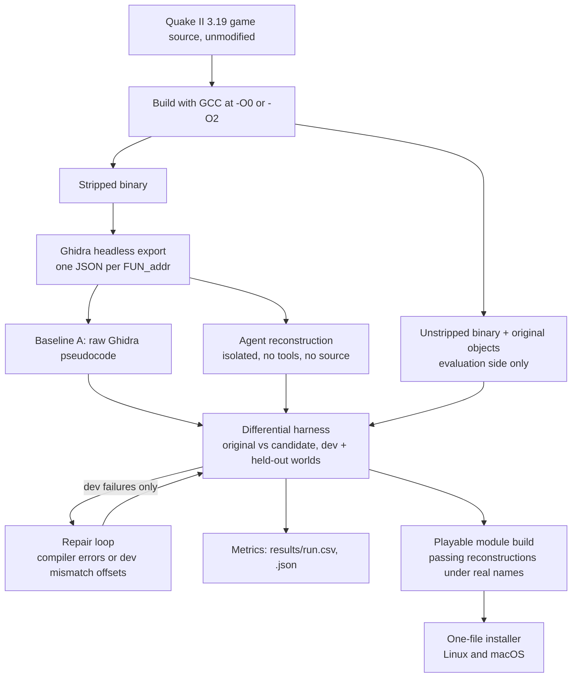

# quake2-llm-decompile

Code, harness and results for [Agent-Assisted Reconstruction of Quake II Gameplay Code](https://palindromerice.github.io/writing/quake2-reconstruction/).
Quake II's gameplay module (about a thousand C functions) is compiled, stripped and decompiled with
Ghidra. Coding agents rewrite each function in C without seeing the source, and a differential
harness compares every rewrite against the original on generated game worlds. Raw decompiler output
matches for fewer than 9% of functions; after agent reconstruction and repair, **99.0%** match in the
unoptimized build (981 of 991) and **98.5%** in the optimized build (964 of 979). The installed module
(1,018 of 1,019 functions reconstructed) is playable in Yamagi Quake II on Linux and Mac.

## Why

Most decompilation projects aim for *matching* output (same bytes back), which needs the original
compiler. This project asks whether agents can produce code that simply *behaves* like the original.

A game is a hard test: functions share global state and exact data layouts. Quake II is large and
stateful, and id Software's GPL source release provides ground truth.

## How it works



1. **Build and strip.** Unmodified sources are built at `-O0` and `-O2`; only the stripped binary
   reaches Ghidra and the agents.
2. **Extraction.** Ghidra exports only what it recovered, never original names; misses are failures.
3. **Reconstruction.** One isolated call per function via `AGENT_CMD`: prompt on stdin, answer out.
4. **Stateful differential harness.** Two forked processes build the same seeded random world; one
   calls the original, one the candidate, and all game state, return values and engine calls are
   compared against a deterministic stand-in engine.
5. **Repair loop.** Up to two rounds of compiler errors or dev mismatch offsets; held-out never shown.
6. **Playable build.** Passing reconstructions replace originals under real names; play-tested.
7. **Installer.** A one-file installer on the
   [v1.0 release](https://github.com/palindromeRice/quake2-llm-decompile/releases/tag/v1.0) builds the
   engine and module with id Software's free demo data.

## Evaluation

- **Pass rule.** No mismatch and at least one usable world in both dev and held-out splits (up to
  1,500 worlds each); agreement on tested worlds, not proven equivalence.
- **Zero-case audit.** Passes where nothing was compared are excluded (10 at `-O0`, 9 at `-O2`).
- **Bug injection.** Single-edit mutants of 100 sampled functions: 269 of 329 caught (82%).
- **Controls.** Ten newly written functions passed 10 of 10 at `-O0` and 9 of 10 at `-O2`.

## Results

| Stage | Unoptimized (991 functions) | Optimized (979 functions) |
|---|---:|---:|
| Ghidra baseline | 86 (8.7%) | 76 (7.8%) |
| First agent response | 949 (95.8%) | 918 (93.8%) |
| After repair | 981 (99.0%) | 964 (98.5%) |

The builds used different agent configurations, so the gap is not purely an optimization effect.
28 installed functions were never harness tested: 1,018 reconstructed is not 1,018 verified.

### Evidence in this repository

Raw run records (prompts, answers, reconstructions) are kept by the author and not published. The
files in `results/` are enough to recompute every number above: each CSV has one row per function and
attempt with its category, pass flags for the dev and held-out splits, and the test-case counts used
by the zero-case audit (a pass counts only when both splits compared at least one case).

| File | Backs |
|---|---|
| `results/20261013-010856-game_all_O0.csv` | Table, unoptimized build: 86 / 949 / 981 of 991 |
| `results/20261013-095717-game_all_O2.csv` | Table, optimized build: 76 / 918 / 964 of 979 |
| `results/mutation_game_all_O0_sample100.json` | Bug injection: 269 of 329 mutants caught (82%) |
| `results/20261012-225442-control_O0.csv` | Newly written control functions, unoptimized: 10 of 10 pass |
| `results/20261012-225643-control_O2.csv` | Newly written control functions, optimized: 9 of 10 pass |

## Limitations

- **Possible memorization.** Quake II's source has been public for decades, and some reconstructions
  use original function names absent from the prompt. Agents never received the source and the
  newly written controls also passed, but those controls were agent-written. The clean test is a
  game whose source was never released.
- **Test coverage.** Passing shows agreement on tested worlds only. Rarely reached paths get little
  testing (82% of injected bugs caught), and synthetic single-player worlds with a stand-in engine do
  not cover multiplayer or many real-engine interactions.
- **Harness changes.** The harness was improved during the study (pointer comparison, input
  generation). A fully independent check would freeze it and run once on fresh held-out worlds.

## License

The code in this repository is licensed under Apache-2.0 (see `LICENSE` and `NOTICE`). The Quake II
source it builds against is id Software's release under GPL-2.0, see
`docs/QUAKE2_LICENSE_GPLv2.txt`; it is not included here.

The installer on the [v1.0 release](https://github.com/palindromeRice/quake2-llm-decompile/releases/tag/v1.0)
contains reconstructed Quake II game code, which is derived from that GPL-2.0 source and is
distributed under GPL-2.0, not Apache-2.0. No game data is included; the installer downloads id
Software's free demo data.

## Citation

```bibtex
@misc{chawla2026quake2reconstruction,
  author       = {Naman Chawla},
  title        = {Agent-Assisted Reconstruction of Quake II Gameplay Code},
  year         = {2026},
  howpublished = {\url{https://palindromerice.github.io/writing/quake2-reconstruction/}}
}
```

Citation metadata is also in `CITATION.cff`.
